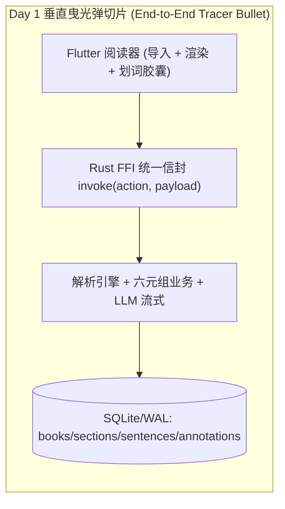
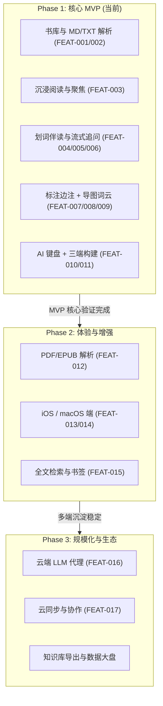

# 产品开发分阶段规划书：AI Reader

- **需求/功能名称**：AI Reader 沉浸式 AI 认知阅读器（从零重写重建）
- **规划编制时间**：2026-10-16
- **规划状态**：FROZEN
- **产品负责人**：开发者
- **当前实施目标**：Phase 1 (MVP)
- **关联设计与需求**：
  - 总览 PRD：`_02_feature_spec/_01_human_prd/overview_prd.md`
  - 宏观品味宪章：`/DESIGN.md`
  - MVP 裁定决策日志：`_06_dev_process/_03_qa_log/qa_log_001_bootstrap_mvp_scope.md`

> [!NOTE]
> **定位原则**：本规划书是产品设计向工程研发演进的战略桥梁。**MVP 范围已在产品设计沟通（审讯）阶段由开发者裁定**（先定范围，再写详细规格，杜绝先全量设计再砍半的返工），本规划书仅把结论落盘。

---

## 1. 核心验证假设、团队胃口 (Appetite) 与 MVP 定位

- **单一核心验证假设 (Single Risky Assumption)**：**"在本地优先、零网络依赖的极简阅读器中，'划词即得 AI 深度解读并一键沉淀为批注'的闭环，能显著提升严肃长文读者的研读效率与心流连续性。"**
- **团队胃口与时间箱 (Appetite & Timebox · 借鉴 Shape Up)**：
  - **胃口规格**：`[ ] Small Batch (1~3 天)` / `[ ] Medium Batch (1~2 周)` / `[x] 不设时间箱，质量优先做到底`（开发者裁定）
  - **断路器原则 (Circuit Breaker)**：若遇未知工程阻塞，**优先砍 Phase 2 特性（PDF/EPUB、iOS/macOS 端）保上线，绝不降低质量门禁**。
- **MVP 核心成功指标**：
  1. 核心主旅程 100% 跑通：`导入 Markdown/TXT → 阅读 → 划词 → 伴读流式返回 → 存为边注`，无阻塞性卡点；
  2. 划词到伴读首帧（TTFT）< 800ms（在线）/ 本地启发式降级 < 10ms；
  3. `make test` 100% PASS、静态检测 0 告警 0 错误、`verify_consistency --strict` 全绿。
- **本阶段总体实施策略**：**垂直曳光弹、单点突破**。Phase 1 聚焦"读懂长文"的核心闭环，图形化知识图谱与多端高级适配按 MoSCoW 与主交付平台排布。

---

## 2. 人机交互对齐备忘录 (Interaction Alignment & CEO Cut)

**MVP 范围裁定发生在产品设计沟通（审讯）阶段，先于详细规格**。以下为确认结论（引用 `_06_dev_process/_03_qa_log/qa_log_001_bootstrap_mvp_scope.md`）：

| 对齐维度 | 核心提问内容 | 决策者确认结论与裁剪依据 |
|---|---|---|
| **单一核心假设** | MVP 最根本解决的单一痛点是什么？ | 确认聚焦"长文研读——划词即得 AI 深读并沉淀边注"的单一闭环。 |
| **CEO 质疑式裁剪** | Agent 对辅助功能（导图/词云、AI 键盘、多端、标注风格、PDF/EPUB）提出裁剪建议，由开发者裁定？ | 开发者最终裁定：**仅裁剪 PDF/EPUB 解析**（MVP 仅 Markdown + TXT）；**导图/词云、AI 键盘、标注多风格均保留 MVP**；**平台收敛为 Linux + Windows + Android**（iOS/macOS 顺延）。 |
| **管理台策略** | 首期是否构建可视化配置后台？ | 本产品为本地单用户应用，无后台/多角色/计费体系，天然 No Admin。 |
| **团队胃口** | 本次开发的时间箱？ | 不设时间箱，质量优先做到底；断路器优先砍 Phase 2 项。 |
| **首日切片与准出** | MVP 首个垂直切片与最终验收断言？ | 确认 Day 1 跑通 `导入→解析入库→渲染→划词→伴读→边注` 端到端切片，以 Gherkin 全绿与阶段 6 门禁为准出。 |

---

## 3. 全量功能池 MoSCoW 分级与分期矩阵

| 功能编号 | 功能名称 | 所属模块 | MoSCoW 分级 | 实施阶段归属 | 裁剪/延期理由 (CEO Cut Rationale) |
|---|---|---|---|---|---|
| `FEAT-001` | 书库管理与文档导入（Markdown/TXT） | `library` | **Must-have** | **Phase 1 (MVP)** | 核心闭环入口 |
| `FEAT-002` | 结构化解析与版心阅读渲染 | `reader` | **Must-have** | **Phase 1 (MVP)** | 核心闭环主体 |
| `FEAT-003` | 聚焦模式与顶栏隐退 | `reader` | **Must-have** | **Phase 1 (MVP)** | 心流体验核心，iA 哲学基石 |
| `FEAT-004` | 划词伴读胶囊 | `companion` | **Must-have** | **Phase 1 (MVP)** | Aha Moment 直达入口 |
| `FEAT-005` | 流式认知伴读卡片与原位追问 | `companion` | **Must-have** | **Phase 1 (MVP)** | 核心价值交付面 |
| `FEAT-006` | LLM 连接与伴读设置 | `companion` | **Must-have** | **Phase 1 (MVP)** | 伴读可用前提（含离线降级） |
| `FEAT-007` | 多维标注与边注管理 | `annotation` | **Must-have** | **Phase 1 (MVP)** | 知识沉淀闭环（开发者保留） |
| `FEAT-008` | 知识导图 | `knowledge` | **Must-have** | **Phase 1 (MVP)** | 开发者保留（不裁剪） |
| `FEAT-009` | 关键词词云 | `knowledge` | **Must-have** | **Phase 1 (MVP)** | 开发者保留（不裁剪） |
| `FEAT-010` | 独立 AI 键盘面板 | `assistant` | **Must-have** | **Phase 1 (MVP)** | 开发者保留（不裁剪） |
| `FEAT-011` | 多端构建与本地数据治理（Linux/Win/Android） | `platform` | **Must-have** | **Phase 1 (MVP)** | 主交付平台契约 |
| `FEAT-012` | PDF / EPUB 解析 | `library` | **Should-have** | Phase 2 | **CEO 裁剪项 C5**：复杂排版解析成本高；先用 MD/TXT 验证核心假设 |
| `FEAT-013` | iOS 端适配 | `platform` | **Should-have** | Phase 2 | **CEO 裁剪项 C3**：平台收敛，验证 Android 后再扩 iOS |
| `FEAT-014` | macOS 端适配 | `platform` | **Should-have** | Phase 2 | **CEO 裁剪项 C3**：平台收敛 |
| `FEAT-015` | 高级全文检索与书签历史 | `reader` | **Could-have** | Phase 2 | 早期书籍量少，基础目录已够用 |
| `FEAT-016` | 云端 LLM 代理与密钥托管 | `companion` | **Won't-have** | Phase 3 | 违背 Local-First；Phase 3 视需求再评估 |
| `FEAT-017` | 多设备云同步与协作共享 | `platform` | **Won't-have** | Phase 3 | 本期坚持本地私有，不做账号体系 |

---

## 4. 阶段一：MVP 实施细则与垂直切片路径 (Tracer Bullet Path)

### 4.1 Day 1 垂直曳光弹切片 (First Vertical Slice)

拒绝"先做完所有表再写后端最后拼前端"的水平脱节切片，首日贯穿全链路：

- **验证目的**：首日跑通 `导入 MD/TXT → 解析入库 → 渲染 → 划词 → 伴读卡片 → 存边注`，完成冒烟演示。

### 4.2 MVP 实施范围 (In-Scope)

- **目标角色**：本地单用户（`ROLE_READER 研读者`）；
- **核心主旅程**：

- **纳入功能清单**：`FEAT-001`~`FEAT-011`；
- **主交付平台**：Linux / Windows / Android；
- **设计语言遵循**：严格继承 `/DESIGN.md`（iA Writer 极简 Tokens、零 emoji、无装饰阴影、版心定宽 700px）。

### 4.3 MVP 明确排除项 (Out-of-Scope / Hard Non-Goals)

- **No Admin in MVP**：无后台/多角色/权限/计费体系；
- 不做 PDF / EPUB 解析（Phase 2）；
- 不做 iOS / macOS 端（Phase 2）；
- 不做云同步 / 账号体系 / 云端 LLM 代理（Phase 3）；
- 不做多设备协作与共享。

### 4.4 MVP 准出与验收断言 (Exit Criteria)

- [ ] Day 1 垂直曳光弹冒烟切片跑通并可演示；
- [ ] 核心角色 100% 顺畅完成"导入→阅读→划词→伴读→边注"主路径；
- [ ] 异常（LLM 未配置/断网/解析失败）有明确界面反馈与原位重试指引，已填草稿不丢失；
- [ ] 三端（Linux/Windows/Android）可构建；Linux 产出可安装包；
- [ ] 通过阶段 6 质量门禁（测试全绿 + 静态零告警 + 一致性 strict）与本地提交。

---

## 5. 阶段二：体验与能力增强阶段规划 (Phase 2)

- **实施目标**：扩展格式覆盖与终端覆盖，提升检索与效率体验。
- **规划特性范围**：
  - `FEAT-012` PDF / EPUB 解析（保留精确坐标锚点）；
  - `FEAT-013` / `FEAT-014` iOS / macOS 端适配；
  - `FEAT-015` 高级全文检索、书签与阅读历史；
- **启动前提**：Phase 1 MVP 核心闭环验证通过、解析引擎与 FFI 契约稳定。

---

## 6. 阶段三：规模化与生态集成阶段规划 (Phase 3)

- **实施目标**：从本地单机走向可选的多设备协同与开放能力。
- **规划特性范围**：
  - `FEAT-016` 云端 LLM 代理与密钥托管（可选，保持本地优先默认）；
  - `FEAT-017` 多设备云同步与协作共享；
  - 阅读数据大盘与知识库导出（Markdown/Anki）；
- **启动前提**：本地核心模型经 Phase 2 考验稳定，用户形成规模化跨端诉求。

---

## 7. 演进路线图与阶段依赖关系

