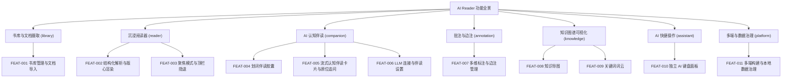

# 产品全景需求总览说明书 (Overview PRD)：AI Reader

- **项目/系统全称**：AI Reader — 沉浸式 AI 认知阅读器与本地知识解构引擎
- **创建时间**：2026-10-16
- **版本**：v1.0.0
- **状态**：FROZEN
- **intent / change_size / work_mode**：`BUILD` / `L` / `DESIGN`
- **宏观品味宪章继承**：`Inherits: /DESIGN.md`
- **对应分阶段规划**：`_01_product_vision/_02_phased_roadmap/ai_reader_phased_plan.md`
- **MVP 裁定决策日志**：`_06_dev_process/_03_qa_log/qa_log_001_bootstrap_mvp_scope.md`
- **对应架构设计**：`_03_architecture_design/_01_system_architecture/ai_reader_system_architecture.md`

> [!NOTE]
> **分级拆分原则**：本项目包含多模块、>3 个功能特性，严禁揉入单一巨型 PRD。本总览仅承载全局愿景、模块划分矩阵与特性索引导航；具体微观施工图分拆至 `features/{feature_key}_prd.md`。

---

## 1. 系统业务全景与模块矩阵 (System Scope & Modules)

| 模块标识 | 模块名称 | 核心职责 | 包含特性清单 |
|---|---|---|---|
| `library` | 书库与文档摄取 | 文档导入（Markdown/TXT）、书库管理、格式识别与去重 | `FEAT-001` |
| `reader` | 沉浸阅读器 | 结构化解析渲染、版心排版、聚焦模式、顶栏隐退 | `FEAT-002`, `FEAT-003` |
| `companion` | AI 认知伴读 | 划词胶囊、4 大认知模板流式伴读、原位追问、LLM 连接与降级 | `FEAT-004`, `FEAT-005`, `FEAT-006` |
| `annotation` | 批注与边注 | 7 样式标注 × 调色板、人工边注、标注管理 | `FEAT-007` |
| `knowledge` | 知识图谱可视化 | 目录/概念知识导图、关键词权重词云 | `FEAT-008`, `FEAT-009` |
| `assistant` | AI 快捷操作 | 独立 AI 键盘面板、作用域解析、快捷唤起 | `FEAT-010` |
| `platform` | 多端与数据治理 | Linux/Windows/Android 构建打包、`~/.ai-reader` 集中存储、迁移 | `FEAT-011` |

---

## 2. 全局功能特性索引映射表 (Feature Index Matrix)

> 索引核心：本表由 `doc_index_db.py` 自动化提取并建立全局检索索引。

| 特性ID | 特性名称 | 所属模块 | 优先级 | 状态 | 规格说明书路径 (PRD) | 界面原型路径 (Prototype) |
|---|---|---|---|---|---|---|
| `FEAT-001` | 书库管理与文档导入 | `library` | `P0` | `active` | `features/library_import_prd.md` | `_02_feature_spec/_04_prototype_wireframe/library_import_prototype.md` |
| `FEAT-002` | 结构化解析与版心阅读渲染 | `reader` | `P0` | `active` | `features/reader_render_prd.md` | `_02_feature_spec/_04_prototype_wireframe/reader_render_prototype.md` |
| `FEAT-003` | 聚焦模式与顶栏隐退 | `reader` | `P0` | `active` | `features/reader_focus_mode_prd.md` | `_02_feature_spec/_04_prototype_wireframe/reader_focus_mode_prototype.md` |
| `FEAT-004` | 划词伴读胶囊 | `companion` | `P0` | `active` | `features/companion_pill_prd.md` | `_02_feature_spec/_04_prototype_wireframe/companion_pill_prototype.md` |
| `FEAT-005` | 流式认知伴读卡片与原位追问 | `companion` | `P0` | `active` | `features/companion_stream_prd.md` | `_02_feature_spec/_04_prototype_wireframe/companion_stream_prototype.md` |
| `FEAT-006` | LLM 连接与伴读设置 | `companion` | `P0` | `active` | `features/companion_settings_prd.md` | `_02_feature_spec/_04_prototype_wireframe/companion_settings_prototype.md` |
| `FEAT-007` | 多维标注与边注管理 | `annotation` | `P0` | `active` | `features/annotation_styles_prd.md` | `_02_feature_spec/_04_prototype_wireframe/annotation_styles_prototype.md` |
| `FEAT-008` | 知识导图 | `knowledge` | `P1` | `active` | `features/knowledge_mindmap_prd.md` | `_02_feature_spec/_04_prototype_wireframe/knowledge_mindmap_prototype.md` |
| `FEAT-009` | 关键词词云 | `knowledge` | `P1` | `active` | `features/knowledge_wordcloud_prd.md` | `_02_feature_spec/_04_prototype_wireframe/knowledge_wordcloud_prototype.md` |
| `FEAT-010` | 独立 AI 键盘面板 | `assistant` | `P1` | `active` | `features/assistant_keyboard_prd.md` | `_02_feature_spec/_04_prototype_wireframe/assistant_keyboard_prototype.md` |
| `FEAT-011` | 多端构建与本地数据治理 | `platform` | `P0` | `active` | `features/platform_distribution_prd.md` | `_02_feature_spec/_04_prototype_wireframe/platform_distribution_prototype.md` |

---

## 3. 全局功能架构树 (System Functional Architecture Tree)

---

## 4. 全局用户角色与权限动线 (Global Personas & Access Matrix)

| 角色标识 | 角色名称 | 核心诉求 | 涉及模块 |
|---|---|---|---|
| `ROLE_READER` | 深度研读者（唯一角色） | 不被打断地读懂长文；就地获得 AI 深读；本地私有沉淀批注与知识 | `library`, `reader`, `companion`, `annotation`, `knowledge`, `assistant`, `platform` |

> **权限模型**：本地单用户应用，无登录/多角色/权限体系；所有数据存于本机 `~/.ai-reader`，默认零网络出站（仅用户显式配置的 LLM 端点为唯一外部依赖）。

---

## 5. 全局设计语言与体验基线 (继承 `/DESIGN.md`)

- **具象隐喻**：安静的排版纸 / iA Writer 打字机工作台。
- **核心体验律**：Typography-first（正文一等公民）、渐进式披露（控件按需浮现）、心流不打断、零 emoji、无装饰性阴影/渐变。
- **跨特性复用**：`FrostedModal`（毛玻璃模态）、`FloatingActionPill`（划词胶囊）、`WindowControls`（单标题栏）、Design Tokens（见 `vibe_spec` 各特性代码映射）。

---

## 6. 全局非功能约束 (Non-Functional Baseline)

- **本地优先**：核心解析与 NLP 计算 100% 离线；唯一外部依赖为用户配置的 LLM 端点，且必须支持离线启发式降级。
- **性能**：10 万字文档冷启动解构 < 1.5s；图谱构建 < 200ms；划词胶囊唤出 < 50ms；滚动 60fps。
- **数据韧性**：SQLite WAL 模式、原子事务、崩溃自恢复；运行期产物集中于 `~/.ai-reader`（可配置重定位 + 旧位置自动迁移）。
- **隐私**：本地数据不出机；日志脱敏；LLM 密钥存于本地配置且不回显明文。
- **多端契约**：统一 C-ABI FFI 信封 `ai_reader_invoke(action, payload_json)`，三端共享同一 Rust 引擎。
