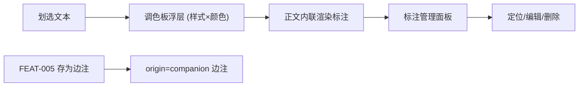

# 产品设计语言与界面原型规范：多维标注与边注管理 (FEAT-007)

- **功能模块**：`annotation` / `FEAT-007`
- **关联 PRD**：`_02_feature_spec/_01_human_prd/features/annotation_styles_prd.md`
- **可交互 HTML 原型预览**：`_02_feature_spec/_03_prototype_html/ai_reader_prototype.html`
- **宏观品味宪章继承**：`Inherits: /DESIGN.md`　**状态**：FROZEN

## 1. 视觉调性
- **隐喻**：纸质书上的随手批注——在原文之上叠加克制的记号与边注。**密度**：`Airy`。

## 2. Design Tokens（局部）
调色板 6 色（黄/绿/蓝/粉/紫/橙，见 `/DESIGN.md`）；`--anno-panel-width 360px`；样式：下划/波浪/加粗/斜体/删除线/半高亮/高亮。

## 3. UX 四定律落地
1. **渐进式披露**：划选→调色板浮层（样式×颜色）；管理面板按需打开。
2. **视觉层级**：一级=正文中的标注样式；二级=边注内容；三级=来源/时间。
3. **费茨**：色块 ≥24px；样式按钮 ≥32px。
4. **微文案**：`写点什么…`（占位符）；删除=二次确认"移除该标注？"。

## 4. 核心组件六态（调色板/管理行）
| 组件 | Default | Hover/Focus | Active | Loading | Disabled | Error |
|---|---|---|---|---|---|---|
| 样式按钮 | ghost mono | accent 底 | 下压 | — | — | — |
| 色块 | 圆形 24px | 2px ring | 选中勾 | — | — | — |
| 管理行 | 白 1px 底边 | 背景微亮 | — | — | — | — |

## 5. 双轨原型

### 5.1 轨一：标注创建与管理拓扑


### 5.2 轨二：四态 ASCII 线框
#### 状态一：正常数据态（调色板浮层）
```text
+----------------------------------------------------------------------+
|  深度的专注 ___仪式感___ 来守护……   ← 正文内联: 下划线(蓝) + 高亮(黄)   |
|        +-------------------------------------------------+           |
|        | 样式: [下划线][波浪][加粗][斜体][删除线][半高亮][高亮] |         |
|        | 颜色: ●黄 ●绿 ●蓝 ●粉 ●紫 ●橙     [ 写边注… ]        |  ← 调色板 |
|        +-------------------------------------------------+           |
+----------------------------------------------------------------------+
```

#### 状态二：空态 (Empty / Annotation Manager)
```text
   +--------------------------------------------+
   |  标注                                           |
   |   [ 空状态插画 64x64 ]                          |
   |   还没有标注                                    |
   |   划选文本即可创建标注或边注                     |
   +--------------------------------------------+
```

#### 状态三：列表态 (Populated / Annotation Manager)
```text
   +----------------------------------------------------------+
   |  标注 (3)                                          ✕      |
   |----------------------------------------------------------|
   |  ▁▁ 深度的专注需要仪式感…   "对抗注意力碎片"   [AI]  定位 编辑 删除 |
   |  波浪  注意力碎片侵入了流…     "疑问：何谓碎片？"  [人工] 定位 编辑 删除 |
   |  ══  仪式是最低成本约束      "（无）"           [人工] 定位 编辑 删除 |
   +----------------------------------------------------------+
```

#### 状态四：删除确认态 (Confirm Delete)
```text
   +--------------------------------------------+
   |  移除该标注？                                |
   |  原文「深度的专注需要仪式感」将被取消标注。   |
   |  该操作可撤销（软删除）。                     |
   |        [ 取消 ]      [ 移除标注 ] ※         |
   +--------------------------------------------+
```

## 6. 与 PRD / Gherkin DoD 映射
| 原型区块 | 关联需求 | 关联 Gherkin |
|---|---|---|
| 调色板 | REQ-001 | TEST-01-CREATE-STYLE-COLOR |
| 存为边注 | REQ-003 | TEST-02-COMPANION-NOTE-IDEMPOTENT |
| 编辑 | REQ-002 | TEST-03-EDIT-NOTE-PERSIST |
| 重叠 | REQ-005 | TEST-04-OVERLAP-CLEAN |

## 7. 开发者可视化确认签收单
| # | 检查项 | 状态 |
|---|---|---|
| 1 | 调色板/管理面板容器明确 | [x] PASS |
| 2 | 样式图标与边注字阶 | [x] PASS |
| 3 | 6 色调色板与 Tokens 一致 | [x] PASS |
| 4 | 桌面浮层 / 移动长按 | [x] PASS |
| 5 | 四态（浮层/空/列表/删除确认） | [x] PASS |
| 6 | 可映射为组件树 | [x] PASS |

- **签收结论**：APPROVED　**日期**：2026-10-16
