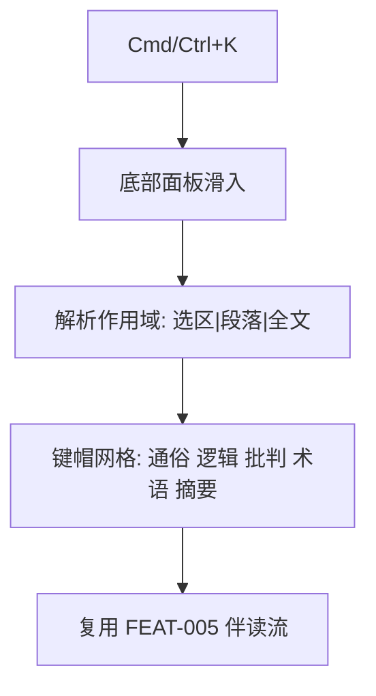

# 产品设计语言与界面原型规范：独立 AI 键盘面板 (FEAT-010)

- **功能模块**：`assistant` / `FEAT-010`
- **关联 PRD**：`_02_feature_spec/_01_human_prd/features/assistant_keyboard_prd.md`
- **可交互 HTML 原型预览**：`_02_feature_spec/_03_prototype_html/ai_reader_prototype.html`
- **宏观品味宪章继承**：`Inherits: /DESIGN.md`　**状态**：FROZEN

## 1. 视觉调性
- **隐喻**：一枚从底部升起的极简键帽托盘。**密度**：`Balanced`。

## 2. Design Tokens（局部）
`--keyboard-panel-height 200px`、`--keycap-radius 8px`、`--keycap-border 1px #E5E7EB`、`--keycap-font iA Writer Mono 13px`。

## 3. UX 四定律落地
1. **渐进式披露**：面板仅在 `Cmd+K` 时滑入；正文不动。
2. **视觉层级**：一级=键帽网格；二级=作用域提示。
3. **费茨/希克**：键帽 ≥ 64px 热区，恰好 5 项（≤5）。
4. **微文案**：`未选中文本，将对当前段落执行`（回退提示，人话）。

## 4. 核心组件六态（键帽）
| 组件 | Default | Hover/Focus | Active | Loading | Disabled | Error |
|---|---|---|---|---|---|---|
| 键帽 | 白底 1px 8px 圆角 | accent 边 + 数字键提示 | 下压 | — | — | — |

## 5. 双轨原型

### 5.1 轨一：拓扑


### 5.2 轨二：四态 ASCII 线框
#### 状态一：正常数据态（面板展开）
```text
+----------------------------------------------------------------------+
|  第二章 专注的仪式                                                    |
|  深度的专注需要仪式感来守护……  （正文保持不变，不遮挡上半区）          |
|----------------------------------------------------------------------|
|  作用域: 当前段落 (未选中文本，将对当前段落执行)          Esc 关闭     |
|   +--------+ +--------+ +--------+ +--------+ +--------+            |
|   | 通俗 1 | | 逻辑 2 | | 批判 3 | | 术语 4 | | 摘要 5 |            |  键帽 ≥64px
|   +--------+ +--------+ +--------+ +--------+ +--------+            |
+----------------------------------------------------------------------+
```

#### 状态二：选区作用域态 (Selection scope)
```text
|  作用域: 选区「深度的专注需要仪式感来守护」                          |
```

#### 状态三：执行态 (Dispatch)
```text
|  作用域: 当前段落        ▸ 已发起逻辑链伴读…                          |
```

#### 状态四：关闭态 (Closed)
```text
+----------------------------------------------------------------------+
|  第二章 专注的仪式                                                    |
|  深度的专注需要仪式感来守护……  （Esc / 点击外部 → 面板收起，正文不变） |
+----------------------------------------------------------------------+
```

## 6. 与 PRD / Gherkin DoD 映射
| 原型区块 | 关联需求 | 关联 Gherkin |
|---|---|---|
| 面板 + 作用域 | REQ-001/002 | TEST-01-SUMMON-SCOPE |
| 键帽执行 | REQ-003 | TEST-02-KEYCAP-EXECUTE |
| 关闭 | REQ-004 | TEST-03-CLOSE |

## 7. 开发者可视化确认签收单
| # | 检查项 | 状态 |
|---|---|---|
| 1 | 底部停靠面板容器明确 | [x] PASS |
| 2 | 键帽 mono 13px 字阶 | [x] PASS |
| 3 | 8px 圆角 / 无 emoji | [x] PASS |
| 4 | 桌面快捷键 + 数字键 | [x] PASS |
| 5 | 四态（正常/选区/执行/关闭） | [x] PASS |
| 6 | 可映射为组件 | [x] PASS |

- **签收结论**：APPROVED　**日期**：2026-10-16
