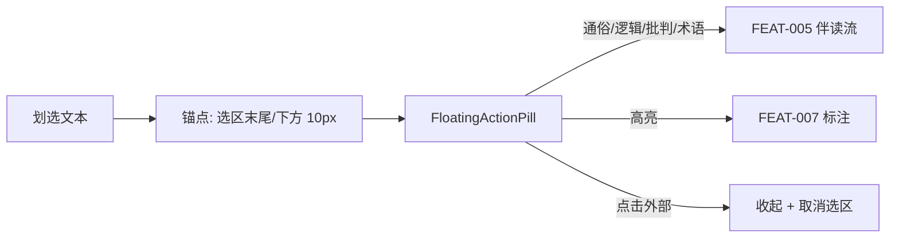

# 产品设计语言与界面原型规范：划词伴读胶囊 (FEAT-004)

- **功能模块**：`companion` / `FEAT-004`
- **关联 PRD**：`_02_feature_spec/_01_human_prd/features/companion_pill_prd.md`
- **可交互 HTML 原型预览**：`_02_feature_spec/_03_prototype_html/ai_reader_prototype.html`
- **宏观品味宪章继承**：`Inherits: /DESIGN.md`　**状态**：FROZEN

## 1. 视觉调性
- **隐喻**：正文里冒出的一个纯色药丸——克制、就地、零阴影。**密度**：`Airy`。

## 2. Design Tokens（局部）
`--pill-bg #FFFFFF`、`--pill-border 1px #E5E7EB`、`--pill-radius 20px`、`--pill-offset-y 10px`、`--pill-label-font iA Writer Mono 12px`、`--pill-hover-accent #007AFF`、`shadow: none`。

## 3. UX 四定律落地
1. **渐进式披露**：仅在划选后浮现，其余时间完全隐去。
2. **视觉层级**：唯一强调=药丸（accent 悬停）。
3. **费茨**：锚定选区末尾下方 10px，移动距离最短；热区 ≥36px。
4. **微文案**：`[通俗][逻辑][批判][术语][高亮]`（mono 文字，零 emoji，动词化命名）。

## 4. 核心组件六态（药丸标签）
| 组件 | Default | Hover | Active | Loading | Disabled | Error |
|---|---|---|---|---|---|---|
| PillLabel | 白底 1px 边 | 文字 accent 蓝 | 轻微下压 | — | — | — |
| 胶囊体 | 20px 圆角 | 保持 | 保持 | — | — | — |

## 5. 双轨原型

### 5.1 轨一：锚定与流转拓扑


### 5.2 轨二：四态 ASCII 线框
#### 状态一：正常数据态（跟随选区）
```text
+--------------------------------------------------------------------------+
|  第二章 专注的仪式                                                        |
|                                                                          |
|  深度的专注需要仪式感来守护，让注意力不被碎片信息侵入。                    |
|             >>> 划选这一句 <<<                                           |
|        +---------------------------------------------+                   |
|        | [通俗] [逻辑] [批判] [术语] [高亮]           |  ← 药丸: 20px圆角  |  选区下方 10px
|        +---------------------------------------------+     1px边框 零阴影 |  mono 12px
+--------------------------------------------------------------------------+
```

#### 状态二：越界自适应态 (Edge flip)
```text
+--------------------------------------------------------------------------+
|        +---------------------------------------------+                   |
|        | [通俗] [逻辑] [批判] [术语] [高亮]           |  ← 翻转到选区上方  |  贴近底边时
|        +---------------------------------------------+                   |
|  最后一段靠近窗口底边的文本 >>> 划选 <<<                                   |
+--------------------------------------------------------------------------+
```

#### 状态三：收起态 (Dismissed)
```text
+--------------------------------------------------------------------------+
|  第二章 专注的仪式                                                        |
|  深度的专注需要仪式感来守护…… （点击胶囊外任意区域 → 药丸与选区同步收起）   |
+--------------------------------------------------------------------------+
```

#### 状态四：未配置引导态 (Guide)
```text
+--------------------------------------------------------------------------+
|        +-----------------------------------------------------------+      |
|        | 需要先配置 AI 伴读连接                                      |      |
|        | [ 打开设置 ] ※ (36px accent)    [ 取消 ] (次级)            |      |
|        +-----------------------------------------------------------+      |
+--------------------------------------------------------------------------+
```

## 6. 与 PRD / Gherkin DoD 映射
| 原型区块 | 关联需求 | 关联 Gherkin |
|---|---|---|
| 药丸标签 | REQ-001/002 | TEST-01-PILL-REVEAL-ANCHOR / TEST-02-NO-EMOJI-LABELS |
| 收起 | REQ-003 | TEST-03-CLICK-OUTSIDE-DISMISS |
| 越界翻转 | REQ-004 | TEST-04-EDGE-FLIP |
| 未配置引导 | REQ-005 | TEST-05-UNCONFIGURED-GUIDE |

## 7. 开发者可视化确认签收单
| # | 检查项 | 状态 |
|---|---|---|
| 1 | 容器尺寸/锚定规则明确 | [x] PASS |
| 2 | mono 12px 标签字阶 | [x] PASS |
| 3 | 20px 圆角 / 零阴影 / accent 悬停 | [x] PASS |
| 4 | 桌面鼠标 + 移动长按 | [x] PASS |
| 5 | 四态（跟随/翻转/收起/引导） | [x] PASS |
| 6 | 可映射为 Overlay 组件 | [x] PASS |

- **签收结论**：APPROVED　**日期**：2026-10-16
