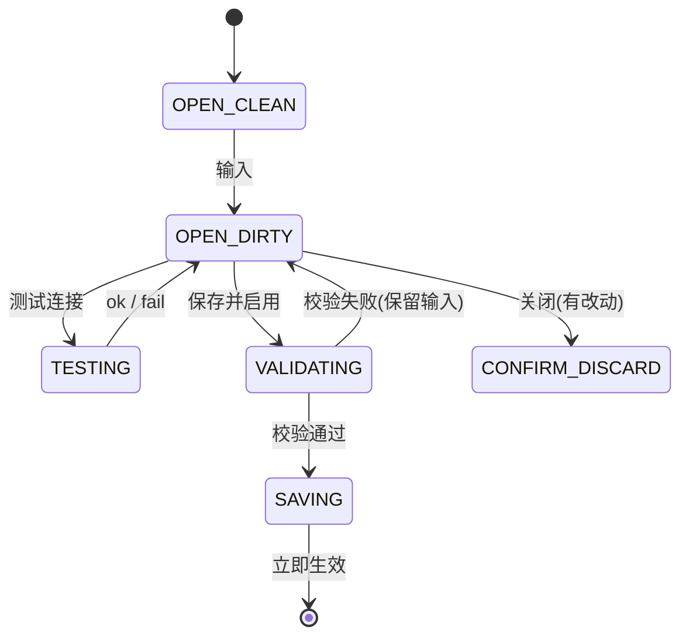

# 产品设计语言与界面原型规范：LLM 连接与伴读设置 (FEAT-006)

- **功能模块**：`companion` / `FEAT-006`
- **关联 PRD**：`_02_feature_spec/_01_human_prd/features/companion_settings_prd.md`
- **可交互 HTML 原型预览**：`_02_feature_spec/_03_prototype_html/ai_reader_prototype.html`
- **宏观品味宪章继承**：`Inherits: /DESIGN.md`　**状态**：FROZEN

## 1. 视觉调性
- **隐喻**：一张极简的接线说明卡——三项必填 + 一个测试按钮。**密度**：`Airy`。

## 2. Design Tokens（局部）
`--dialog-width 520px`、`--field-radius 6px`、`--status-ok #1B873F`、`--status-fail #D9383A`、`--field-focus-ring 2px #007AFF`。

## 3. UX 四定律落地
1. **渐进式披露**：首屏 3 必填 + 测试/保存；高级参数（温度/超时/重试）折叠。
2. **视觉层级**：一级=三必填字段；二级=状态徽标；三级=高级折叠。
3. **费茨**：按钮 ≥36px；保存为主 CTA 唯一 accent。
4. **微文案**：`测试连接`/`保存并启用`（具象）；错误=原因+修复（"端点不可达，请检查 URL 与网络"）。

## 4. 核心组件六态（字段/按钮）
| 组件 | Default | Hover/Focus | Active | Loading | Disabled | Error |
|---|---|---|---|---|---|---|
| 输入框 | 1px #E5E7EB 6px | 2px accent ring | — | — | 灰底只读 | 红框 + 原位提示 |
| 保存按钮 | accent 实心 | 亮度+8% | 98% | 锁宽 spinner | 校验未过禁用 | — |
| 状态徽标 | 灰(unknown) | — | — | 测试中 spinner | — | 红(fail)/绿(ok) |

## 5. 双轨原型

### 5.1 轨一：模态拓扑与状态机


### 5.2 轨二：四态 ASCII 线框
#### 状态一：正常数据态
```text
   +------------------------------------------------------+
   |  伴读连接设置                                   ✕    |
   |------------------------------------------------------|
   |  API 地址      [ https://api.openai.com/v1         ] |  6px 圆角
   |  API Key       [ ••••••••••••••••  (掩码)          ] |  永不回显明文
   |  模型          [ gpt-4o-mini                       ] |
   |  高级参数 ▾    (温度 / 超时 / 重试 —— 渐进折叠)      |
   |------------------------------------------------------|
   |  状态: ● 连接正常         [测试连接] [ 保存并启用 ] ※|  绿 ok / accent 主CTA
   +------------------------------------------------------+
```

#### 状态二：校验拦截态 (Validation)
```text
   +------------------------------------------------------+
   |  伴读连接设置                                   ✕    |
   |------------------------------------------------------|
   |  模型          [ (空)                              ] |
   |                └ 请填写模型名称，例如 gpt-4o-mini     |  红框 + 原位提示
   |  API 地址      [ https://api.openai.com/v1         ] |  已填内容 100% 保留
   |------------------------------------------------------|
   |  状态: ● 未测试           [测试连接] [ 保存并启用 ]  |
   +------------------------------------------------------+
```

#### 状态三：测试中态 (Testing)
```text
   |  状态: ◐ 正在测试连接…     [ 测试中… ] (锁宽 spinner) |
```

#### 状态四：失败态 (Fail + 修复指引)
```text
   +------------------------------------------------------+
   |  状态: ● 连接失败 (#D9383A)                          |
   |  └ 端点不可达，请检查地址与网络；或点击「跳过，使用离线摘要」|
   |         [ 跳过，使用离线摘要 ]  [ 保存并启用 ]        |
   +------------------------------------------------------+
```

## 6. 与 PRD / Gherkin DoD 映射
| 原型区块 | 关联需求 | 关联 Gherkin |
|---|---|---|
| 三必填 + 测试 | REQ-001/002 | TEST-01-TEST-CONNECT-OK |
| 校验红框 | REQ-004 | TEST-02-REQUIRED-INLINE |
| 密钥掩码 | REQ-003 | TEST-03-KEY-NEVER-PLAINTEXT |
| 跳过 | REQ-005 | TEST-04-SKIP-OFFLINE |

## 7. 开发者可视化确认签收单
| # | 检查项 | 状态 |
|---|---|---|
| 1 | 对话框 520px 容器明确 | [x] PASS |
| 2 | 字段 6px 圆角 / 标签字阶 | [x] PASS |
| 3 | accent 仅用于主 CTA（≤1 处） | [x] PASS |
| 4 | 桌面模态交互 | [x] PASS |
| 5 | 四态（正常/校验/测试/失败） | [x] PASS |
| 6 | 可映射为组件树 + 状态机 | [x] PASS |

- **签收结论**：APPROVED　**日期**：2026-10-16
