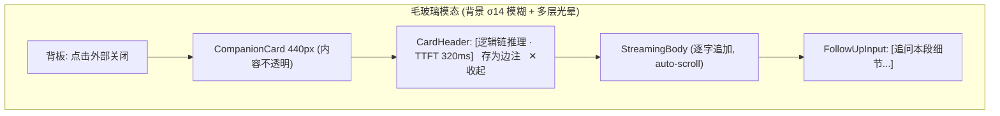

# 产品设计语言与界面原型规范：流式认知伴读卡片与原位追问 (FEAT-005)

- **功能模块**：`companion` / `FEAT-005`
- **关联 PRD**：`_02_feature_spec/_01_human_prd/features/companion_stream_prd.md`
- **可交互 HTML 原型预览**：`_02_feature_spec/_03_prototype_html/ai_reader_prototype.html`
- **宏观品味宪章继承**：`Inherits: /DESIGN.md`　**状态**：FROZEN

## 1. 视觉调性
- **隐喻**：浮在朦胧纸面之上的一张清晰认知卡片（毛玻璃模态，内容不透明）。**密度**：`Airy`。

## 2. Design Tokens（局部）
`--modal-blur-sigma 14`、`--modal-glow-blur 40/90/150`、`--modal-width 440px`、`--modal-enter 240ms fade + 0.96→1.0`、`--card-border 1px #E5E7EB`。

## 3. UX 四定律落地
1. **渐进式披露**：卡片只呈现模板标签 + 流式正文 + 一行追问；高级（重试/切换模板）收进 header。
2. **视觉层级**：一级=流式正文（主视觉）；二级=模板标签 + TTFT（mono）；三级=降级角标。
3. **费茨**：`[存为边注][✕收起]` 右上角 32px 热区；追问输入框整行可点。
4. **微文案**：`存为边注`（具象）；降级=「离线降级」角标 + 原因说明。

## 4. 核心组件六态（卡片/追问框）
| 组件 | Default | Hover/Focus | Active | Loading | Disabled | Error |
|---|---|---|---|---|---|---|
| 卡片 | 白底 1px 边 12px 圆角 | — | — | 逐字流式 | — | 降级角标 |
| 追问框 | 1px 边 6px 圆角 | 2px accent focus ring | — | 提交 spinner | 空内容禁用 | 原位提示 |
| 存为边注 | ghost mono | accent | 下压 | — | 已归档禁用 | — |

## 5. 双轨原型

### 5.1 轨一：模态空间与流转拓扑


### 5.2 轨二：四态 ASCII 线框
#### 状态一：正常数据态（流式中）
```text
      (背景整屏高斯模糊 σ14 + 轻度压暗)
   +------------------------------------------------+
   |  [逻辑链推理 · TTFT 320ms]        存为边注  ✕   |   header (mono 12px)
   |------------------------------------------------|
   |  本段的推理链为三步：                           |
   |  1) 专注需要外部约束来对抗注意力碎片化；        |   正文 15px / 行高 1.6
   |  2) 仪式感是最低成本的约束信号；                |
   |  3) 因此深度阅读需先建立进入仪式……▌             |   光标逐字流出
   |------------------------------------------------|
   |  [ 追问本段细节...                       ↵ ]   |   单行输入 6px 圆角
   +------------------------------------------------+
```

#### 状态二：降级态 (Fallback / 离线降级)
```text
   +------------------------------------------------+
   |  [通俗解读 · 本地降级]            存为边注  ✕   |
   |------------------------------------------------|
   |  (离线降级角标 ●) 网络暂不可用，已使用本地启发式：|
   |  本段主要强调"专注需要仪式感"这一核心观点。     |
   |------------------------------------------------|
   |  [ 追问本段细节...                       ↵ ]   |
   +------------------------------------------------+
```

#### 状态三：加载态 (Loading / TTFT pending)
```text
   +------------------------------------------------+
   |  [逻辑链推理 · 生成中…]           存为边注  ✕   |
   |------------------------------------------------|
   |  ░░░░░░░░░░░░░░░░░░░░░░░░░░░░░░░░              |   占位脉冲
   |  ░░░░░░░░░░░░░░░░░░░░                          |   （禁用空白等待屏）
   |------------------------------------------------|
   |  [ 追问本段细节...（等待首字）           ↵ ]   |
   +------------------------------------------------+
```

#### 状态四：异常态 (Error + 原位重试)
```text
   +------------------------------------------------+
   |  [逻辑链推理]                    存为边注  ✕    |
   |------------------------------------------------|
   |  [ ! ] 连接失败：端点无响应。已保留你的选区。   |   #D9383A
   |  请检查网络后重试，或改用离线摘要。             |
   |        [ ↻ 重新生成 ] (次级)  [ 用离线摘要 ]   |
   +------------------------------------------------+
```

## 6. 与 PRD / Gherkin DoD 映射
| 原型区块 | 关联需求 | 关联 Gherkin |
|---|---|---|
| header + 流式正文 | REQ-001/002 | TEST-01-STREAM-TTFT |
| 追问输入 | REQ-003 | TEST-02-FOLLOWUP-INLINE |
| 降级角标 | REQ-005 | TEST-03-FALLBACK |
| 存为边注 | REQ-004 | TEST-04-SAVE-NOTE-IDEMPOTENT |

## 7. 开发者可视化确认签收单
| # | 检查项 | 状态 |
|---|---|---|
| 1 | 模态 440px / 光晕融入背景 | [x] PASS |
| 2 | 模板标签 mono + TTFT tabular-nums | [x] PASS |
| 3 | 12px 圆角 / 无硬边框 / Tokens 一致 | [x] PASS |
| 4 | 桌面模态 / 移动 Bottom Sheet | [x] PASS |
| 5 | 四态（流式/降级/加载/错误） | [x] PASS |
| 6 | 可映射为组件树 + 状态机 | [x] PASS |

- **签收结论**：APPROVED　**日期**：2026-10-16
