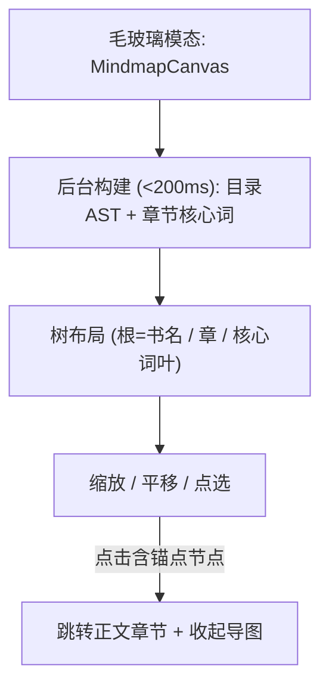

# 产品设计语言与界面原型规范：知识导图 (FEAT-008)

- **功能模块**：`knowledge` / `FEAT-008`
- **关联 PRD**：`_02_feature_spec/_01_human_prd/features/knowledge_mindmap_prd.md`
- **可交互 HTML 原型预览**：`_02_feature_spec/_03_prototype_html/ai_reader_prototype.html`
- **宏观品味宪章继承**：`Inherits: /DESIGN.md`　**状态**：FROZEN

## 1. 视觉调性
- **隐喻**：一张极简的知识树蓝图（无彩色、无发光）。**密度**：`Balanced`。

## 2. Design Tokens（局部）
`--mindmap-node-font ui-sans 13px`、`--mindmap-edge bezier`、`--mindmap-scale 0.5~2.5`。

## 3. UX 四定律落地
1. **渐进式披露**：默认展示两级；深层节点按需展开。
2. **视觉层级**：一级=根/章节点；二级=核心词叶；三级=权重辅文。
3. **费茨**：节点热区 ≥ 40px；缩放用滚轮。
4. **微文案**：空态="内容过少，暂无导图"。

## 4. 核心组件六态（节点/画布）
| 组件 | Default | Hover/Focus | Active | Loading | Disabled | Error |
|---|---|---|---|---|---|---|
| 节点 | 1px 边框圆角 6px | 边框 accent | 选中填充浅灰 | — | — | — |
| 画布 | 白底 | — | 拖拽平移 | 骨架图 | — | 空态 |

## 5. 双轨原型

### 5.1 轨一：拓扑与交互


### 5.2 轨二：四态 ASCII 线框
#### 状态一：正常数据态
```text
   +-----------------------------------------------------------+
   |  知识导图                                           ✕      |
   |-----------------------------------------------------------|
   |                    ● 深度工作                              |
   |                 ┌──┴───────────────┐                      |
   |          ● 第一章 专注力            ● 第二章 仪式           |
   |         ┌──┴──┐                   ┌──┴──┐                 |
   |       ○碎片  ○界限              ○约束  ○习惯               |
   |  [滚轮缩放 · 拖拽平移 · 点击节点跳转章节]                    |
   +-----------------------------------------------------------+
```

#### 状态二：空态 (Empty)
```text
   |                      内容过少，暂无导图                     |
   |                       [ ← 返回阅读 ]                       |
```

#### 状态三：加载态 (Loading)
```text
   |      ░░░░░░░   (根节点骨架)                                 |
   |     ░░░░  ░░░░                                              |
```

#### 状态四：折叠态 (Large doc / collapsed)
```text
   |                    ● 深度工作                               |
   |                 ┌──┴──┐                                    |
   |          ● 第一章     ● 第二章   (40+ 节点默认折叠至二级)   |
   |              [ 展开以查看核心词 ]                            |
```

## 6. 与 PRD / Gherkin DoD 映射
| 原型区块 | 关联需求 | 关联 Gherkin |
|---|---|---|
| 树画布 | REQ-001 | TEST-01-BUILD-AND-RENDER |
| 节点跳转 | REQ-003 | TEST-02-NODE-JUMP |
| 兜底/空态 | REQ-004 | TEST-03-FALLBACK-MINIMAL |

## 7. 开发者可视化确认签收单
| # | 检查项 | 状态 |
|---|---|---|
| 1 | 模态画布容器明确 | [x] PASS |
| 2 | 节点字阶 13px | [x] PASS |
| 3 | 克制配色 / 无发光 | [x] PASS |
| 4 | 桌面滚轮缩放 / 移动手势 | [x] PASS |
| 5 | 四态（正常/空/加载/折叠） | [x] PASS |
| 6 | 可映射为画布组件 | [x] PASS |

- **签收结论**：APPROVED　**日期**：2026-10-16
