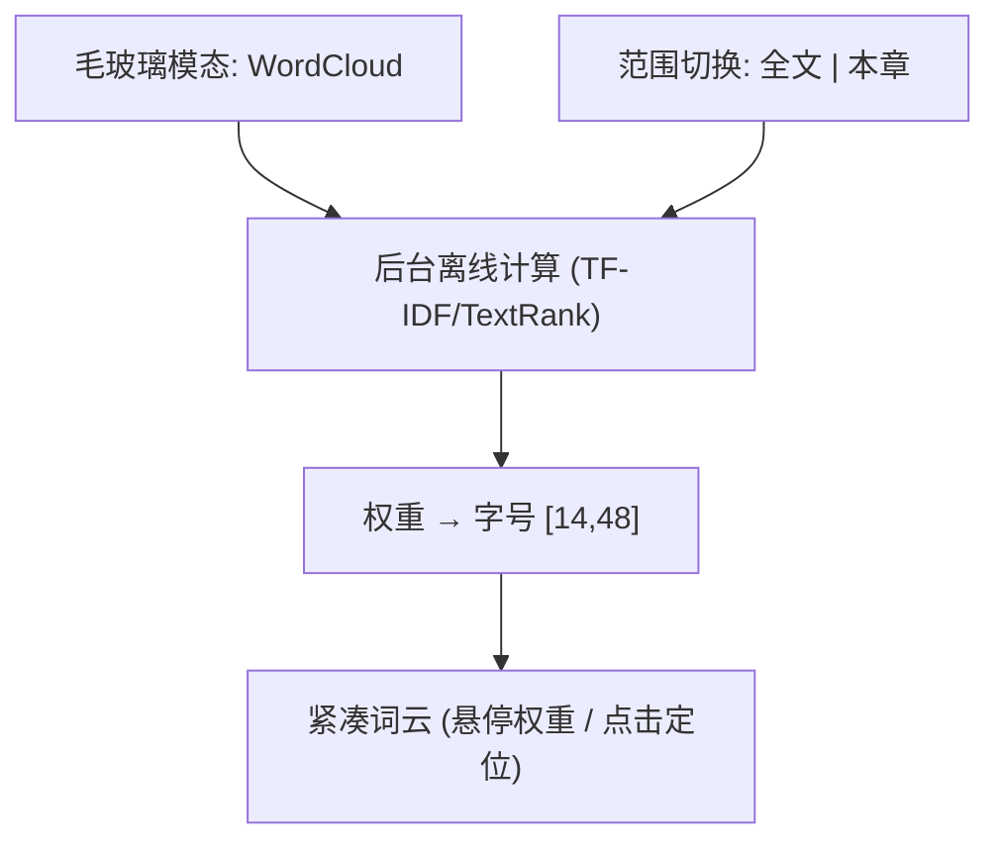

# 产品设计语言与界面原型规范：关键词词云 (FEAT-009)

- **功能模块**：`knowledge` / `FEAT-009`
- **关联 PRD**：`_02_feature_spec/_01_human_prd/features/knowledge_wordcloud_prd.md`
- **可交互 HTML 原型预览**：`_02_feature_spec/_03_prototype_html/ai_reader_prototype.html`
- **宏观品味宪章继承**：`Inherits: /DESIGN.md`　**状态**：FROZEN

## 1. 视觉调性
- **隐喻**：一张按重要性排布的语义索引卡（字号即权重，克制配色）。**密度**：`Balanced`。

## 2. Design Tokens（局部）
`--wordcloud-font 14~48px`（权重线性映射）、主色 `#111827` / 次色 `#6B7280`。

## 3. UX 四定律落地
1. **渐进式披露**：默认全文范围；章节范围可切换。
2. **视觉层级**：一级=高权重大字；二级=中权重；三级=低权重小字。
3. **费茨**：词可点（热区≈字盒）；悬停显示权重。
4. **微文案**：空态="内容过少，暂无词云"。

## 4. 核心组件六态（词/范围切换）
| 组件 | Default | Hover | Active | Loading | Disabled | Error |
|---|---|---|---|---|---|---|
| 词 | 字号=权重 | 下划线 + 显示权重 | 下压 | — | — | — |
| 范围切换 | 分段控件 | 微亮 | 选中填充 | — | — | — |

## 5. 双轨原型

### 5.1 轨一：拓扑


### 5.2 轨二：四态 ASCII 线框
#### 状态一：正常数据态
```text
   +------------------------------------------------------+
   |  关键词            [ 全文 | 本章 ]              ✕      |
   |------------------------------------------------------|
   |       专注                                               |
   |   仪式        注意力碎片                                  |
   |      深度工作        习惯       约束                      |
   |  纸面   界限   心流   排版   （字号=权重，悬停显权重）      |
   +------------------------------------------------------+
```

#### 状态二：切换态 (Section scope)
```text
   |  关键词            [ 全文 | 本章 ]              ✕      |
   |    (重算本章权重) 仪式   约束   习惯                      |
```

#### 状态三：空态 (Empty)
```text
   |                内容过少，暂无词云                        |
   |                 [ ← 返回阅读 ]                          |
```

#### 状态四：加载态 (Loading)
```text
   |        ░░░    ░░░░░░   ░░░░   (脉冲占位)                 |
```

## 6. 与 PRD / Gherkin DoD 映射
| 原型区块 | 关联需求 | 关联 Gherkin |
|---|---|---|
| 词云 | REQ-001 | TEST-01-RENDER-WEIGHTED |
| 点击定位 | REQ-003 | TEST-02-JUMP |
| 空态 | REQ-004 | TEST-03-EMPTY |

## 7. 开发者可视化确认签收单
| # | 检查项 | 状态 |
|---|---|---|
| 1 | 模态容器明确 | [x] PASS |
| 2 | 字号映射区间明确 | [x] PASS |
| 3 | 克制配色 | [x] PASS |
| 4 | 桌面悬停 / 移动点按 | [x] PASS |
| 5 | 四态（正常/切换/空/加载） | [x] PASS |
| 6 | 可映射为组件 | [x] PASS |

- **签收结论**：APPROVED　**日期**：2026-10-16
