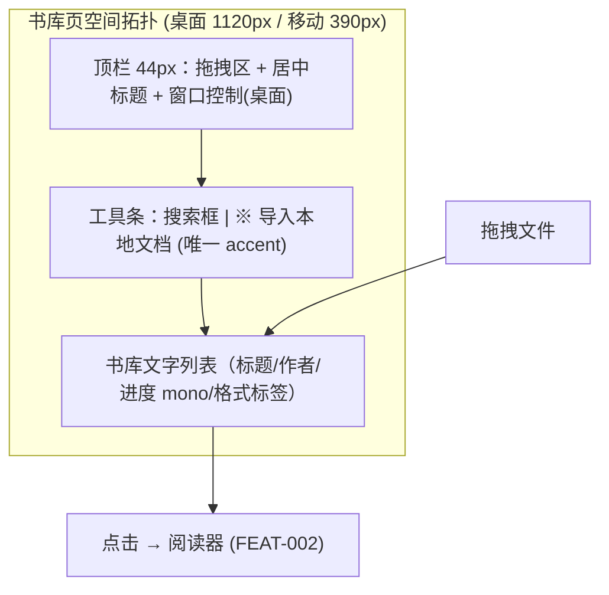

# 产品设计语言与界面原型规范：书库管理与文档导入 (FEAT-001)

- **功能模块**：`library` / `FEAT-001`
- **介质形式**：双轨原型（Mermaid 拓扑 + ASCII 空间比例线框） / UX 四定律 / Design Tokens
- **关联 PRD**：`_02_feature_spec/_01_human_prd/features/library_import_prd.md`
- **可交互 HTML 原型预览**：`_02_feature_spec/_03_prototype_html/ai_reader_prototype.html`
- **宏观品味宪章继承**：`Inherits: /DESIGN.md`　**状态**：FROZEN

> 全量继承 `/DESIGN.md`（iA Writer 极简、零 emoji、无装饰阴影）；本文件仅定义书库特的局部流转与四态线框。

## 1. 视觉调性 (Aesthetic & Mood)
- **隐喻**：一张极简的书架清单——纯文字列表，无封面墙。**密度**：`Airy`。

## 2. Design Tokens
全量继承全局 Token。局部扩展：`--lib-row-height: 64px`、`--lib-list-max: 1120px`。

## 3. UX 四定律落地
1. **渐进式披露**：首屏仅「导入文档」主 CTA + 搜索；排序/批量/高级过滤收进折叠。
2. **视觉层级**：一级=标题 + 唯一主 CTA `※ 导入本地文档`；二级=作者/进度；三级=格式标签/导入时间。
3. **费茨/希克**：行高 64px 充足热区；并列操作 ≤ 5。
4. **微文案**：`导入本地文档`（具象）；错误=原因+修复（"当前版本仅支持 Markdown 与 TXT"）。

## 4. 核心组件六态
| 组件 | Default | Hover/Focus | Active | Loading | Disabled | Error |
|---|---|---|---|---|---|---|
| 主 CTA | accent 实心 36px | 亮度+8%，2px focus ring | 缩放 98% | 锁宽 spinner | 40% 透明 | — |
| 列表行 | 白底 1px 底边 | 背景 #F9FAFB | 轻微下压 | 骨架 | — | — |

## 5. 双轨原型

### 5.1 轨一：空间划分与流转拓扑


### 5.2 轨二：四态 ASCII 线框
#### 状态一：正常数据态 (Populated)
```text
+----------------------------------------------------------------------------+
| [Canvas 1120px, Bg #FAFAFA, Font ui-sans]              [─] [□] [✕] (桌面)  | 顶栏 44px,拖拽移动
|                        我的书库 (居中 13px #6B7280)                          |
+----------------------------------------------------------------------------+
| [ 搜索标题… (200ms debounce) ]            [ 导入本地文档 ] ※ (36px accent)|
+----------------------------------------------------------------------------+
| 深度工作   (Cal Newport)      [MD]   ▓▓▓▓▓░░░ 62%  ·  2 小时前              | 64px 行高
| 论人类不平等的起源  (卢梭)    [TXT]  ▓░░░░░░░  8%  ·  昨天                  |
| 认知设计  (Don Norman)        [MD]   ▓▓▓▓▓▓▓▓100%  ·  3 天前                |
+----------------------------------------------------------------------------+
  [注] ※ 唯一 accent；进度数字 tabular-nums；点击行进入阅读。
```

#### 状态二：空白引导态 (Empty / FTUE)
```text
+----------------------------------------------------------------------------+
|                        我的书库 (0)                                        |
|                  [ 引导插画: 打开的线装书 80x80 ]                          |
|                 还没有任何文档          (H2 18px w600 #111827)              |
|    把 Markdown 或 TXT 拖入窗口，开始沉浸式阅读与 AI 伴读 (Body 14px #6B7280)|
|        [ 导入本地文档 ] ※ (36px accent)     [ 载入示例文章 ] (次级)          |
+----------------------------------------------------------------------------+
```

#### 状态三：加载骨架态 (Loading)
```text
+----------------------------------------------------------------------------+
| ░░░░░░░░░░░░░░░░░░ (标题骨架 24px)          ░░░░░░░░░░ (按钮骨架 120x36)    |
| ░░░░░░░░░░░░░░░░░░░░░░░░░░░  ░░░░░░  ░░░░░░░░   (行高 64px, CLS=0)         |
| ░░░░░░░░░░░░░░░░░░░░░░░  ░░░░░░░░  ░░░░░░░░  (每行 1:1 对齐真实列表)        |
+----------------------------------------------------------------------------+
```

#### 状态四：异常/拦截态 (Error)
```text
+----------------------------------------------------------------------------+
| [ ! 提示 48x48 ]                                                           |
| 当前版本仅支持 Markdown 与 TXT            (H2 18px w600 #D9383A)             |
| PDF/EPUB 将在后续版本支持，请先转换或更换文件 (Body 14px #6B7280)            |
|                     [ ↻ 重新选择文件 ] (次级 36px)                          |
+----------------------------------------------------------------------------+
```

## 6. 与 PRD / Gherkin DoD 映射
| 原型区块 | 关联需求 | 关联 Gherkin |
|---|---|---|
| 工具条 + 列表 | REQ-001 | TEST-01-IMPORT-HAPPY |
| 空态 CTA | REQ-004 | TEST-04-EMPTY-FTUE |
| 拦截态 | REQ-003 | TEST-03-UNSUPPORTED-INLINE |

## 7. 开发者可视化确认签收单
| # | 检查项 | 状态 |
|---|---|---|
| 1 | 多端容器与布局（桌面 1120 / 移动 390） | [x] PASS |
| 2 | 字阶层级（H2 18 / Body 14 / mono 进度 tabular-nums） | [x] PASS |
| 3 | 间距与 Tokens（行高 64 / 4-8 步进 / accent ≤3） | [x] PASS |
| 4 | 终端平台交互（桌面快捷键 / 移动 44px 热区） | [x] PASS |
| 5 | 四态无死角（Empty/Loading/Populated/Error） | [x] PASS |
| 6 | 代码可映射性（组件树 + Tokens） | [x] PASS |

- **签收结论**：APPROVED　**签收工程师**：Developer　**日期**：2026-10-16
