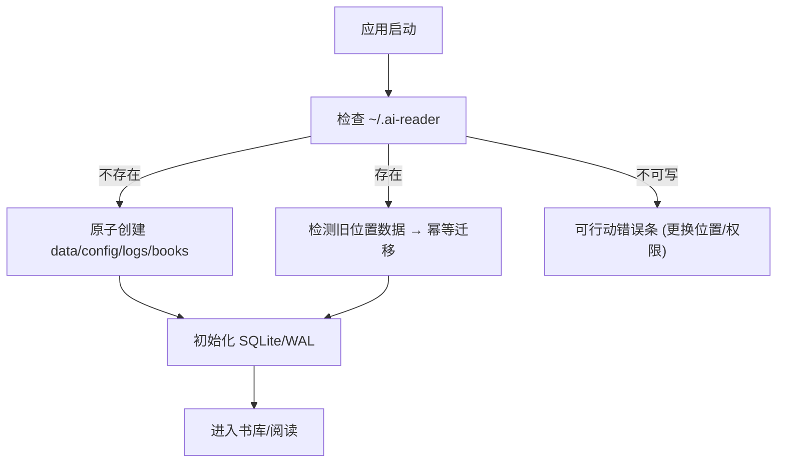

# 产品设计语言与界面原型规范：多端构建与本地数据治理 (FEAT-011)

- **功能模块**：`platform` / `FEAT-011`
- **关联 PRD**：`_02_feature_spec/_01_human_prd/features/platform_distribution_prd.md`
- **可交互 HTML 原型预览**：`_02_feature_spec/_03_prototype_html/ai_reader_prototype.html`
- **宏观品味宪章继承**：`Inherits: /DESIGN.md`　**状态**：FROZEN

## 1. 视觉调性
- **隐喻**：一条安静的启动流水线——用户几乎无感。**密度**：`Airy`（大部分无 UI，仅错误/迁移有界面）。

## 2. Design Tokens（局部）
全量继承 `/DESIGN.md`。局部：`--home-banner-height 40px`（迁移/错误条）。

## 3. UX 四定律落地
1. **渐进式披露**：正常启动零打扰；仅异常/迁移时出现轻量条。
2. **视觉层级**：一级=错误原因；二级=修复动作。
3. **费茨**：修复按钮 ≥36px。
4. **微文案**：`数据目录不可写，请更换位置或调整权限`（原因+修复）。

## 4. 核心组件六态（数据位置提示条）
| 组件 | Default | Info | Loading | Success | Error |
|---|---|---|---|---|---|
| Banner | 隐藏 | 迁移中提示 | spinner | 迁移完成(自隐) | 红条 + 修复按钮 |

## 5. 双轨原型

### 5.1 轨一：启动流转拓扑


### 5.2 轨二：四态 ASCII 线框
#### 状态一：正常态（无 UI 打扰）
```text
+----------------------------------------------------------------------+
|                          AI Reader 启动中…                           |  (瞬时, 无打扰)
|         (静默创建 ~/.ai-reader/{data,config,logs,books} 后进入书库)    |
+----------------------------------------------------------------------+
```

#### 状态二：迁移态 (Migrating)
```text
|  ◐ 正在迁移历史数据到 ~/.ai-reader…（完成后自动隐藏）                    |
```

#### 状态三：完成态 (Success, auto-hide)
```text
|  ● 数据已迁移到 ~/.ai-reader                                            |
```

#### 状态四：错误态 (Not writable)
```text
+----------------------------------------------------------------------+
|  [ ! ] 数据目录不可写 (#D9383A)                                       |
|  原因：~/.ai-reader 权限不足。                                         |
|  修复：更换数据位置，或调整该目录权限后重试。                           |
|        [ 更换数据位置… ]   [ ↻ 重试 ]                                 |
+----------------------------------------------------------------------+
```

## 6. 与 PRD / Gherkin DoD 映射
| 原型区块 | 关联需求 | 关联 Gherkin |
|---|---|---|
| 静默创建 | REQ-001 | TEST-01-FIRST-RUN-HOME |
| 迁移条 | REQ-002 | TEST-02-LEGACY-MIGRATION |
| 错误条 | REQ-006 | TEST-03-NOT-WRITABLE |

## 7. 开发者可视化确认签收单
| # | 检查项 | 状态 |
|---|---|---|
| 1 | 启动无 UI / 错误条容器明确 | [x] PASS |
| 2 | 提示条字阶 | [x] PASS |
| 3 | Tokens 一致 / 无装饰 | [x] PASS |
| 4 | 桌面/移动一致行为 | [x] PASS |
| 5 | 四态（正常/迁移/完成/错误） | [x] PASS |
| 6 | 可映射为启动状态机 | [x] PASS |

- **签收结论**：APPROVED　**日期**：2026-10-16
