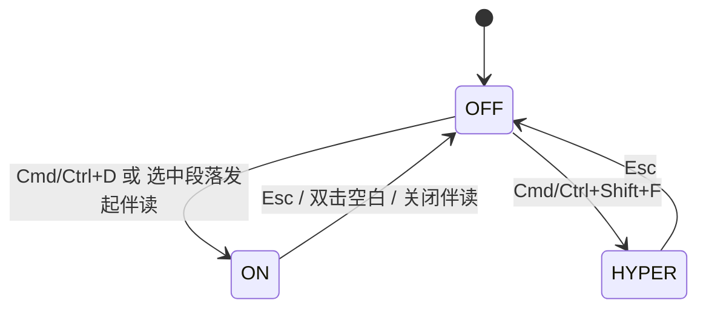

# 产品设计语言与界面原型规范：聚焦模式与顶栏隐退 (FEAT-003)

- **功能模块**：`reader` / `FEAT-003`
- **关联 PRD**：`_02_feature_spec/_01_human_prd/features/reader_focus_mode_prd.md`
- **可交互 HTML 原型预览**：`_02_feature_spec/_03_prototype_html/ai_reader_prototype.html`
- **宏观品味宪章继承**：`Inherits: /DESIGN.md`　**状态**：FROZEN

## 1. 视觉调性
- **隐喻**：灯光聚焦下的纸面——只有当前段落被照亮，四周柔和隐入暗处。**密度**：`Airy`。

## 2. Design Tokens（局部）
`--dim-opacity: 0.65`、`--focus-transition: 150ms ease-out`、`--header-idle-timeout: 3000ms`。

## 3. UX 四定律落地
1. **渐进式披露**：聚焦态下隐去一切 chrome，仅留正文。
2. **视觉层级**：一级=当前段（100%）；二级=上下邻近段（65% 轮廓）。
3. **费茨**：快捷键 `Cmd+D` / `Cmd+Shift+F`，无需精确点击。
4. **微文案**：无提示气泡（禁止非用户触发弹窗）。

## 4. 核心组件六态（暗化层 / 顶栏）
| 组件 | Default | Focus ON | Hyper Focus | Reduced-motion | Disabled | Error |
|---|---|---|---|---|---|---|
| 暗化层 | opacity 1 | 非焦段 0.65 | 仅正文 | 瞬时（无动画） | — | — |
| 顶栏 | 可见 | 仍隐退 | 隐藏 | 瞬时 | — | — |

## 5. 双轨原型

### 5.1 轨一：状态迁移拓扑


### 5.2 轨二：对比 ASCII 线框
#### 正常态 (Focus OFF)
```text
+--------------------------------------------------------------+
| ≡ 目录            深度工作                     AI 伴读        | 顶栏可见
|  第一段：上下文清晰 100% 对比度                              |
|  第二段：上下文清晰 100% 对比度                              |
|  第三段：上下文清晰 100% 对比度                              |
+--------------------------------------------------------------+
```

#### 聚焦态 (Focus ON) — 当前段 100%，其余 65%（150ms 过渡）
```text
+--------------------------------------------------------------+
|                    (顶栏已淡出 opacity 0)                     |
|  第一段：柔和弱化 ┈┈┈┈┈┈┈┈  (opacity 0.65)                  |
|  第二段：柔和弱化 ┈┈┈┈┈┈┈┈  (opacity 0.65)                  |
|  ▶ 当前聚焦段：100% 高对比度清晰可读，心流不被分散。          | (opacity 1.0)
|  第三段：柔和弱化 ┈┈┈┈┈┈┈┈  (opacity 0.65)                  |
|  第四段：柔和弱化 ┈┈┈┈┈┈┈┈  (opacity 0.65)                  |
+--------------------------------------------------------------+
```

#### 超级专注态 (Hyper Focus) — 零 chrome
```text
+--------------------------------------------------------------+
|                                                              |
|         只有当前段落文字，全黑/全白背景，除正文外零元素。       |
|                                                              |
+--------------------------------------------------------------+
```

#### 减动效回退态 (Reduced-motion)
```text
+--------------------------------------------------------------+
|  [prefers-reduced-motion] 焦距切换以「瞬时」方式生效，无过渡动画 |
+--------------------------------------------------------------+
```

## 6. 与 PRD / Gherkin DoD 映射
| 原型区块 | 关联需求 | 关联 Gherkin |
|---|---|---|
| 聚焦态 | REQ-001 | TEST-01-FOCUS-PARAGRAPH |
| 顶栏隐退 | REQ-002 | TEST-02-HEADER-AUTOHIDE |
| Esc 恢复 | REQ-003 | TEST-03-ESC-RESTORE |
| 减动效 | REQ-005 | TEST-04-REDUCED-MOTION |

## 7. 开发者可视化确认签收单
| # | 检查项 | 状态 |
|---|---|---|
| 1 | 聚焦/超级专注容器明确 | [x] PASS |
| 2 | 字阶继承版心规范 | [x] PASS |
| 3 | dim 0.65 / 150ms / Tokens 一致 | [x] PASS |
| 4 | 桌面快捷键 + 减动效 respect | [x] PASS |
| 5 | 四态（正常/聚焦/超级/减动效） | [x] PASS |
| 6 | 可映射为状态机 | [x] PASS |

- **签收结论**：APPROVED　**日期**：2026-10-16
