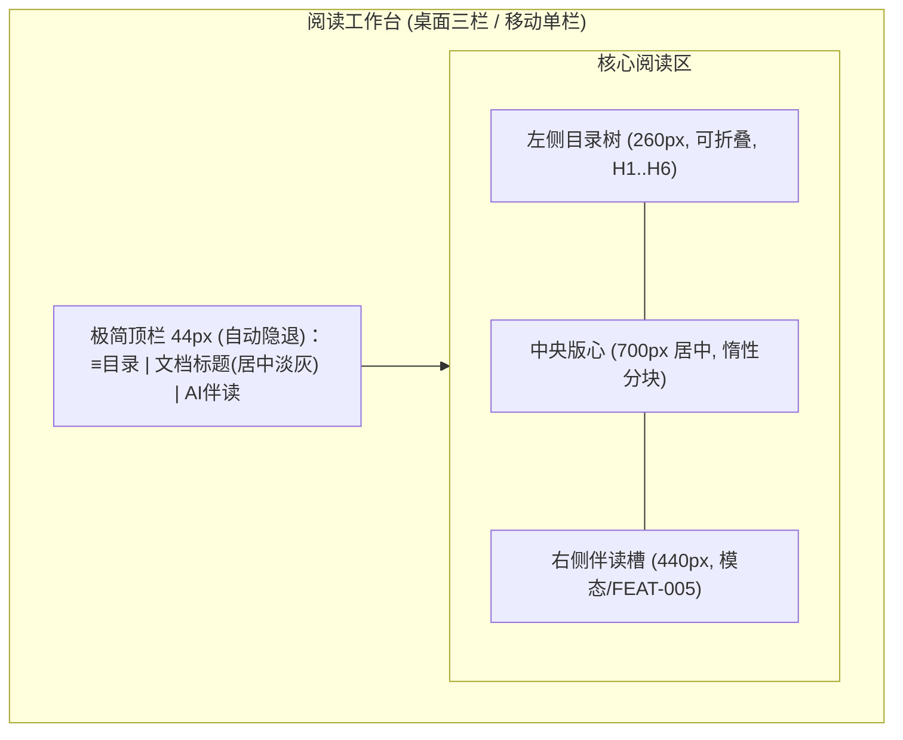

# 产品设计语言与界面原型规范：结构化解析与版心阅读渲染 (FEAT-002)

- **功能模块**：`reader` / `FEAT-002`
- **关联 PRD**：`_02_feature_spec/_01_human_prd/features/reader_render_prd.md`
- **可交互 HTML 原型预览**：`_02_feature_spec/_03_prototype_html/ai_reader_prototype.html`
- **宏观品味宪章继承**：`Inherits: /DESIGN.md`　**状态**：FROZEN

## 1. 视觉调性 (Aesthetic & Mood)
- **隐喻**：安静的排版纸（iA Writer 打字机工作台）。**密度**：`Airy`。三栏工作台，界面静默隐退。

## 2. Design Tokens（局部）
`--reading-column-max: 700px`、`--reader-font: iA Writer Duo 19/1.7`、`--toc-width: 260px`、`--header-height: 44px`。

## 3. UX 四定律落地
1. **渐进式披露**：首屏=正文 + 自动隐退顶栏；目录/伴读按需滑出。
2. **视觉层级**：一级=正文版心（唯一主视觉）；二级=章节标题；三级=页码/进度（mono）。
3. **费茨/希克**：目录项 44px 高；顶部导航 ≤3。
4. **微文案**：无营销文案；骨架屏与降级提示用真实业务语言。

## 4. 核心组件六态
| 组件 | Default | Hover/Focus | Active | Loading | Disabled | Error |
|---|---|---|---|---|---|---|
| 目录项 | 13px #6B7280 | 背景微亮 + accent 左边条 | — | — | — | — |
| 正文块 | 版心 700 | 划选高亮 | — | 首屏骨架 | — | 降级纯文本 |

## 5. 双轨原型

### 5.1 轨一：空间拓扑


### 5.2 轨二：四态 ASCII 线框
#### 状态一：正常数据态 (Populated)
```text
+--------------------------------------------------------------------------------+
| ≡ 目录            深度工作 (居中 13px #6B7280)                    AI 伴读        | 顶栏44,自动隐退
+---------------+----------------------------------------------------------------+
| ▸ 第一章       |            [版心: 700px 居中, iA Writer Duo 19/1.7]            |
| ● 第二章  ※    |  第二章 专注的仪式                                             | 章节 H2
|   ├ 小节 A     |                                                                |
|   └ 小节 B     |  深度的专注需要仪式感来守护……这是一段正在深度阅读的正文，       | 段间 1.2em
| ▸ 第三章       |  排版纯粹宁静，没有繁杂按钮干扰。                               |
|                |                                                                |
|  [目录260px]   |  >>> 划选此句可唤起药丸 [通俗 逻辑 批判 术语 高亮] <<<            |
|                |                                                                |
|                |  接续下一段深刻论述，保持 60fps 丝滑滚动。                      |
+---------------+----------------------------------------------------------------+
  [注] 顶栏 3s 无操作或下滚淡出；上滚/指针停留唤出；正文定宽保证 38~45 中文字/行。
```

#### 状态二：空白态 (Empty)
```text
+--------------------------------------------------------------------------------+
|                                该文档内容为空                                    |
|                          [空状态插画 64x64]                                     |
|                  请返回书库导入包含正文的 Markdown 或 TXT 文档                   |
|                            [ ← 返回书库 ] (次级)                                |
+--------------------------------------------------------------------------------+
```

#### 状态三：加载骨架态 (Loading / CLS=0)
```text
+--------------------------------------------------------------------------------+
|              ░░░░░░░░░░░░░░░░░░░  (标题骨架 H2 对齐真实标题)                     |
|  ░░░░░░░░░░░░░░░░░░░░░░░░░░░░░░░░░░░░░░░░░  (段落骨架: 行高 1.7 一致)          |
|  ░░░░░░░░░░░░░░░░░░░░░░░░░░░░  ░░░░░░░░░░░░░░░░░░░░░░  (6 块脉冲)              |
+--------------------------------------------------------------------------------+
```

#### 状态四：异常/降级态 (Error / Degraded)
```text
+--------------------------------------------------------------------------------+
| [ ! ] 该文档的部分语法无法完整解析，已按纯文本降级渲染                              |
|       您的阅读不受影响，文本与锚点保持可用                     (Body 14px #6B7280)  |
|                                [ ↻ 重新解析 ] (次级)                             |
+--------------------------------------------------------------------------------+
```

## 6. 与 PRD / Gherkin DoD 映射
| 原型区块 | 关联需求 | 关联 Gherkin |
|---|---|---|
| 版心 + 目录 | REQ-001/002/003 | TEST-01-RENDER-TYPOGRAPHY / TEST-02-TOC-ANCHOR |
| 骨架屏 | REQ-004 | TEST-03-LAZY-PERF |
| 降级态 | REQ-006 | TEST-04-MALFORMED-DEGRADE |

## 7. 开发者可视化确认签收单
| # | 检查项 | 状态 |
|---|---|---|
| 1 | 三栏容器与断点清晰 | [x] PASS |
| 2 | 版心 700 / iA Writer Duo 19/1.7 / 页码 mono | [x] PASS |
| 3 | 间距 1.2em / Tokens 一致 / accent ≤3 | [x] PASS |
| 4 | 桌面快捷键 / 移动单栏 | [x] PASS |
| 5 | 四态齐备（含降级态） | [x] PASS |
| 6 | 可映射为组件树 | [x] PASS |

- **签收结论**：APPROVED　**日期**：2026-10-16
